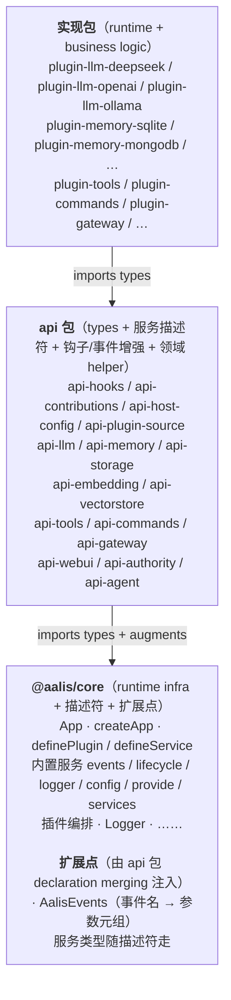

# Aalis 类型分层与 api 包架构

> 本文档描述 Aalis 框架的类型分层原则、api 包契约与扩展点机制。
> 与 [architecture.md](../architecture.md) 互补：架构文档描述运行时数据流，本文档描述编译期类型契约。

## 设计目标

1. **core 业务无关**：`packages/core` 不引用任何 `@aalis/plugin-*` 包，不定义任何业务服务接口（`*Service`）。
2. **接口与实现分离**：每个业务领域（LLM / Memory / Storage / …）由两类包组成：
   - **api 包**（`@aalis/api-*`）：类型、服务描述符（值导出）与扩展点声明
   - **实现包**（`@aalis/plugin-*` 或多个具体实现）：依赖对应 api 包，提供运行时
3. **单向依赖**：`实现包 → api 包 → core`，永不反向。多实现可共存。
4. **扩展点显式化**：core 只保留 `AalisEvents`；钩子与贡献点的扩展点 `HookContextMap` / `ContributionPointMap` 在各自的契约包 `@aalis/api-hooks` / `@aalis/api-contributions`。业务键由 api 包通过 declaration merging 注入。服务类型随描述符走，没有服务名类型表。领域能力（LLM 工具调用/视觉、storage 本地路径权限等）不是 core 扩展点——它们是服务实例 / model handle 上的元数据，由各领域 `*-api` 的 helper 函数（如 `resolveLLMModel`）过滤，不进内核 DI。

## 包分层



## 扩展点

### 1. 服务描述符 — 类型与绑定随契约包走

api 包导出运行时描述符（值导入）。`defineService<Provider>(name)` 不给 `bind`，业务层就是按提供者形状转发的活句柄；需要登记方法或包装调用时给 `bind`，用 `BindingPort.registrar` / `follow` / `track` 与 `port.provider`。

```ts
// api-memory/src/index.ts
export const memory = defineService<MemoryService>('memory');
```

之后消费方 `uses: { memory }`，`apply` 里 `memory` 是选择层，`memory.use` 推断为 `MemoryService`（转发给本插件选中的那一家）。动态按名查询（`services.get('memory')`）没有类型可依凭，由调用方收窄。

> **能力不在这里。** `use` / `list()` / `services.get` 只按服务名解析，**没有** capabilities 参数；同名多实现按「本插件偏好 > 全局偏好 > 优先级 > 注册顺序」选中一家（偏好由用户经 WebUI 的 Services 页或 `servicePreferences` 设）。领域能力（LLM 的 `tool_calling` / `vision` 等）是服务实例 / model handle 上的**元数据**（如 `LLMModel.capabilities`），由各领域 `*-api` 的 helper 函数过滤——见下方「领域能力」。

### 2. `AalisEvents` — 事件名 → 参数元组

```ts
declare module '@aalis/core' {
  interface AalisEvents {
    'scheduler:tick': [jobId: string];
  }
}
```

### 3. `HookContextMap` — 钩子名 → 中间件上下文数据（`@aalis/api-hooks`）

```ts
// api-agent 注入 agent:* 钩子
declare module '@aalis/api-hooks' {
  interface HookContextMap {
    'agent:input:before': { message: IncomingMessage; metadata: Record<string, unknown> };
    'agent:llm:before':   { messages: Message[]; tools: ToolDefinition[]; sessionId: string };
    // ...
  }
}
```

任何在 `hooks.use.middleware('agent:llm:before', ...)` 处签名的消费插件，都需要 **side-effect import**（或常规 import）该 api 包以激活类型增强。

### 4. `ContributionPointMap` — 贡献点名 → spec 类型（`@aalis/api-contributions`）

```ts
// api-agent 注入 agent:prompt 贡献点
declare module '@aalis/api-contributions' {
  interface ContributionPointMap {
    'agent:prompt': PromptContribution;
  }
}
```

`AalisEvents` 与这两张表不在同一个模块里：同一文件要同时增广时，分成 `declare module '@aalis/core'` 与 `declare module '@aalis/api-hooks'` / `'@aalis/api-contributions'` 几个块。

## 领域能力 = handle 元数据（非 core 扩展点）

领域能力是服务实例 / model handle 上的元数据，不是 core 扩展点：

- 有领域能力的 api 包定义自己的能力枚举（如 `api-llm` 的 `LLMCapability` = `chat | tool_calling | vision | thinking | audio | …`），但**不**把它声明进任何 core 接口。
- 能力是**服务实例 / model handle 上的元数据**：provider 在 `provide.use(llm, modelHandle, …)` 时，`modelHandle.capabilities` 诚实反映该 model 能干啥；storage 的读写删由根的 `readable/writable/deletable` 权限位携带，提供者在每个操作前核对，不按能力挑提供者。
- 按能力筛选由各领域 `*-api` 的 **helper 函数**完成，在选择层的 `list()` 上读条目的 `use.capabilities`，与 core DI 无关：

```ts
import { llm, resolveLLMModel } from '@aalis/api-llm';
// apply({ llm }) 之后：
const entry = resolveLLMModel(llm, ref, ['vision']);
await entry?.use.chat({ messages });
```

`provide` 的 options 是 `{ priority?, exclusive?, label?, entryId? }`，没有 `capabilities`；选择层与 `services.get` 只按名字解析。能力字符串也会随模型列表上送前端（webui-server 的 `/api/models/llm` 里各模型的 `capabilities`）供下拉展示与过滤——同样是元数据用途，不是 DI 通道。

## 当前 api 包索引

| api 包 | 注入到 `HookContextMap` | 描述符（服务名） | 注入到 `ContributionPointMap` | 主要服务接口 |
|---|---|---|---|---|
| `api-llm` | — | `llm` | — | `LLMModel`, `ChatModelRequest`, `ChatResponse`, `ChatStreamChunk`；业务层给请求盖上调用方 `caller`；导出 `resolveLLMModel` / `listLLMModels` helper（吃选择层的 `list`，按能力过滤，返回 `ProviderEntry`）；向 schema-config 注入 `'llm-ref'` 字段类型 |
| `schema-config` | — | — | — | 配置表单词汇：`ConfigSchema` / `SchemaField` / `SchemaGroup` / `SchemaArray` + `SchemaFieldTypes` 扩展点、`CORE_CONFIG_SCHEMA`；声明与读取插件配置的 `defineConfig` / `ConfigOf` / `parseConfig`；密钥字段的引用 `SecretRef` 与 `isSecretRef` / `mapSecretFields`（零运行时依赖，对 `@aalis/core` 只有 type-only 锚点；另含对词汇的中立解释函数与配置危险键闸；经 declaration merging 把 `configSchema` 挂到 `PluginMeta`） |
| `api-memory` | `memory:clear` | `memory` / `compression` | — | `MemoryService`, `CompressionService`（压缩，默认提供者 plugin-memory-summary） |
| `api-storage` | — | `storage` | — | `StorageService`；业务层 `BoundStorage` 恒定义 `resolveLocalPath` / `readFileRange` / `watch`，另带本插件私有目录的视图 `own`；导出 URI 文法 helper（`isStorageUri` / `toStorageUri` / `resolveAgainstCwd` 等） |
| `api-embedding` | — | `embedding` | — | `EmbeddingService` |
| `api-vectorstore` | — | `vectorstore` | — | `VectorStoreService` |
| `api-tools` | — | `tools` | — | `ToolService`；工具定义的展示种类 `ToolDisplay`；业务层带 `register` / `registerGroup`，另导出 `withToolGroups` |
| `api-commands` | — | `commands` | — | `CommandService` |
| `api-gateway` | `inbound:command` / `inbound:trigger` / `inbound:flow` / `inbound:dispatch` / `outbound:dispatch` | `gateway` | — | `GatewayService`, `InboundPhaseData`；注入事件 `gateway:phase:done` |
| `api-webui` | — | `webui-server` / `webui-client` | — | `WebUIService`、`PageDefinition`、`Notice`、管理面事件、管理面 REST 的路由表与请求和回应类型、主题格式等；业务层带 `definePage` / `notify`；向 `PluginMeta` 注入 `extends` |
| `api-authority` | — | `authority` | — | `AuthorityService`（含按回合定发起类别的 `originOf`）, `ExecutionGuard`, `ExecutionGuardContext`, `InboundTurn`, `OriginTurn`, `CapabilityVisibility` 等；向 `AalisConfig`（`@aalis/api-host-config`）注入 `owners` 等字段 |
| `api-agent` | `agent:input:before` / `agent:turn:after` / `agent:tool:before` / `agent:tool:after` / `agent:reply:before` / `agent:llm:before` / `agent:llm:after` | `agent` | `agent:prompt` | `AgentService`, `PreprocessorFn`, `PluginGroupInfo` |
| `api-hooks` | （定义该扩展点） | `hooks` | — | `Hooks`, `HookRegistry`, `MiddlewareFn`, `MiddlewareNext`；默认提供者 plugin-hooks |
| `api-contributions` | — | `contributions` | （定义该扩展点） | `Contributions`, `ContributionRegistry`, `ContributionSpec`, `ContributionHandle`；默认提供者 plugin-contributions |
| `api-host-config` | — | `host-config` | — | `HostConfig`，配置文档类型 `AalisConfig`（declaration merging 目标）；由宿主提供 |
| `api-host-paths` | — | `host-paths` | — | `HostPaths`：家目录、安装集与家目录布局的绝对路径；由宿主提供 |
| `api-plugin-source` | — | `plugin-source` | — | `PluginSourceService`；导出插件入口判定 `pluginDefinitionOf`；由宿主提供 |
| `api-reach` | — | `reach` | — | `ReachService`（`forCall` 签发凭据）、`ReachCredential` 与品牌符号、`resolveReach` / `judgeReach`、三张受保护清单 `protectedLists`、`SandboxPolicy` / `sandboxPolicyOf`；向 `SessionConfig`（`@aalis/api-session-manager`）注入 `accessTier`、`accessOnBoundary`；默认提供者 plugin-reach |
| `api-approval` | — | `approvals` | — | `ApprovalService`, `Approval`, `ApprovalRequest`, `ApprovalOutcome`, `ApprovalSettlement`, `ApprovalSurface`；业务层带 `registerSurface`；注入事件 `approval:created` / `approval:settled`；卡片清洗 `sanitizeForCard`；默认提供者 plugin-session-server |
| `api-asr` | — | `asr` | — | `ASRService`, `TranscribeInput`, `TranscribeResult` |
| `api-checkpoint` | — | `checkpoint` | — | `CheckpointService`, `RollbackResult`, `RollbackWithChatResult`；默认提供者 plugin-checkpoint |
| `api-code-sandbox` | — | `code-sandbox` | — | `CodeSandboxService`, `SandboxPolicy`, `SandboxRunRequest`；默认提供者 plugin-code-sandbox-os |
| `api-cron-engine` | — | `cron-engine` | — | `CronEngine`, `CronSubscribeOptions`；转出 `@aalis/util-cron` 的 `CronExprKind` / `ValidateResult` 类型 |
| `api-doctor` | — | `doctor` | — | `DoctorService`, `CheckSpec`, `CheckResult`, `DoctorReport`；业务层带 `registerCheck` |
| `api-flow-control` | — | `flow-control` | — | `FlowControlService`, `FlowSessionStateSnapshot` |
| `api-media` | — | `media` | — | `MediaService`, `MediaProcessor`, `MediaProcessReport` 等 |
| `api-message-archive` | — | `message-archive` | — | `MessageArchiveService` |
| `api-package-manager` | — | `package-manager` | — | `PackageManagerService`, `UpdateTarget`, `UpdateResult`；默认提供者 plugin-package-manager |
| `api-persona` | — | `persona` | — | `PersonaService`, `OutputFormat`, `PersonaSessionOptions` |
| `api-platform` | — | `platform` | — | `PlatformAdapter`, `PlatformConnection`；导出 `getPlatformAdapters` / `resolvePlatformBySession` / `sendPlatformMessage` 等 helper（吃选择层的 `list`，条目是 `ProviderEntry`） |
| `api-process` | — | `process` | — | `ProcessService`, `SpawnOptions`, `ExecResult`；导出 `makeTempDirViaStorage` helper |
| `api-session-history` | — | `session-history` | — | `SessionHistoryService`, `AccessChecker`；默认提供者 plugin-tool-session |
| `api-session-manager` | — | `session-manager` | — | `SessionManagerService`, `SessionConfig`（各插件经 declaration merging 加键）, `SessionSetting`, `SessionInfo`；导出 `sessionKind`；业务层带 `registerSetting` |
| `api-session-protocol` | — | `session-protocol` | — | `SessionProtocolService`, `SessionPeer`, `SessionConnection`；会话协议的 zod schema（`sessionMethods` / `sessionNotifications`、帧与错误码），类型由 schema 推导；默认提供者 plugin-session-server |
| `api-todo-list` | — | `todo-list` | — | `TodoListService`, `TodoItem`；注入事件 `todo:updated`；默认提供者 plugin-todo-list |
| `api-user-relation` | — | `user-relation` | — | `UserRelationService`；默认提供者 plugin-user-relation |
| `api-workflow` | — | `workflow` | — | `WorkflowService`, `WorkflowDef`, `WorkflowRun`, `NodeSpec` 等 |

## 何时需要新建 api 包

满足任一条件即应建立 api 包：

- 该领域有 **>1 个潜在实现**（多 LLM provider、多 memory backend）
- 该领域要 **导出服务描述符**或 **augment** `AalisEvents`（core）、`HookContextMap`（`@aalis/api-hooks`）、`ContributionPointMap`（`@aalis/api-contributions`）（或定义自己的能力枚举 + helper）
- 该领域类型被 **>3 个其他插件**直接 import

只有一个实现且无类型外溢的“叶子插件”（如 plugin-image-sender 内部）不需要 api 包。

## 包该多厚：三类判据

契约包放什么、不放什么，按三条可机检的判据分：

| 后缀 | 放什么 | 判据 |
|---|---|---|
| `util-*` | 与 Aalis 领域**无关**的标准算法 | 换个项目也能原样用（cron 表达式解析、JSON 修复、文本规整） |
| `*-api` | 服务契约 | 导出一个 `defineService` 描述符（值） |
| `schema-*` | 数据格式规范 | Aalis 领域词汇但**不声明服务**、不可能有第二实现（`Message` / `ConfigSchema`） |

`api-cron-engine` 是第一条判据的实例：cron 表达式的解析与匹配是 POSIX 标准算法，
曾长在契约包里占产物 95%，抽成 `@aalis/util-cron` 后契约包从 7919B 降到 411B。

## 导出策略：宁可多导出，不要等人来要

**契约包的公开导出不以「仓内有没有消费者」为条件。** 一个能力只要设计上是给第三方用的，
就直接导出，哪怕仓内暂时没人调。

理由是成本方向不对称：

- 「等有人提 issue 再开放」把成本转嫁给第三方（提 issue → 等排期 → 等发版），还给维护者
  添一轮往返；
- 而**导出是非破坏性的、删除才是破坏性的**。先导出、真长期没人用再议，比反过来安全。

推论：**不要拿「零消费者」当清理理由**去删契约包的导出。`api-platform` 的
`aggregatePlatformConnections`、
`schema-message` 的 `parseAttachmentRefs` 都属此类——仓内零调用，但都是有意提供的能力，
且各有 `docs/api/` 文档在教第三方使用。它们的维护成本近零（纯函数、无状态、类型守着）。

（这与「删死代码」不冲突：**插件与运行时**里的零消费者代码该删，那是实现；契约包的
导出是**接口**，接口的消费者在仓外。）

## 消费约定

### 单纯使用服务（按名解析，无能力参数）

```ts
import { llm } from '@aalis/api-llm';

export default definePlugin({
  name: '@scope/plugin-example',
  uses: { llm },
  apply({ llm }) {
    const model = llm.use; // LLMModel（本插件选中的那一家：本插件偏好 > 全局偏好 > 优先级 > 注册顺序）
  },
});
```

### 按能力挑选实现（领域 helper，非 core DI）

选择层不接受能力参数；要按能力过滤，调对应 api 包的 helper（读 handle 元数据 `use.capabilities`）：

```ts
import { llm, resolveLLMModel } from '@aalis/api-llm';
const entry = resolveLLMModel(llm, ref, ['tool_calling']);
await entry?.use.chat({ messages });
```

### 使用钩子（需要 side-effect 增强）

```ts
import '@aalis/api-agent'; // 激活 agent:* 类型增强
// hooks 是 uses 里声明的选择层（描述符从 @aalis/api-hooks 导入）
hooks.use.middleware('agent:llm:before', async (data, next) => {
  data.tools = data.tools.filter(tool => tool.function.name !== 'example_tool');
  await next();
});
```

往提示词里加内容不走钩子，而是交给 `agent:prompt` 贡献点（见 [api-contributions](../api/api-contributions.md)）。`agent:llm:before` 在一轮内每次调用模型前都会重跑，消息列表跨迭代沿用，在这里追加消息会重复注入；上例每次迭代拿到的 `tools` 都是全量，过滤天然幂等。

如果同时 `import type { ChatResponse } from '@aalis/api-llm'`，则 api-llm 的副作用导入也会一并触发，无需额外 side-effect import。

### 注册自己的服务与钩子

导出描述符，并把钩子上下文挂进 `@aalis/api-hooks` 的 `HookContextMap`（能力枚举留在自己 api 包里，不进 core）：

```ts
// my-service-api/src/index.ts
import type {} from '@aalis/api-hooks'; // declaration merging 锚点
import { defineService, type ServiceSelection } from '@aalis/core';

export type MyCapability = 'feature-a' | 'feature-b';

export interface MyService {
  capabilities: readonly MyCapability[];
}

export const myService = defineService<MyService>('my-service');

declare module '@aalis/api-hooks' {
  interface HookContextMap {
    'my-service:before': { args: unknown; result?: unknown };
  }
}

export function resolveMyService(
  source: Pick<ServiceSelection<MyService>, 'list'>,
  caps?: MyCapability[],
): MyService | undefined {
  return source.list().find(e => (caps ?? []).every(c => e.use.capabilities.includes(c)))?.use;
}
```

服务身份就是描述符的 `name`：两个无关的契约取了同一个名字，它们的提供者会落进同一个服务池。第三方契约的服务名带上包名前缀，如 `@your-scope/api-weather` 的服务取名 `@your-scope/api-weather/forecast`；不带前缀的短名留给第一方 `@aalis/api-*`。同一服务名以不同的描述符对象登记时，core 照常登记，在 `provide` 处记一条 warn，点名两边（成因是契约撞名，或同一个契约包装了两份）。

### 提供一种可登记的能力

工具、命令、页面这类"登记进某个服务、由它派活"的能力，由契约包、枢纽服务、按激活绑定的业务层组成；范本、与原语的共同契约及允许的差异见
[枢纽服务](./hub-services.md)。

## CI 校验

Biome 在 CI 上对全仓库执行 lint + format check（informational 模式）以及对变更文件执行 hard check。业务接口是否回流 core 由代码审查 + 类型系统兜底（任何业务字段重新进入 `packages/core` 都会立刻反映在 PR diff 中）。

