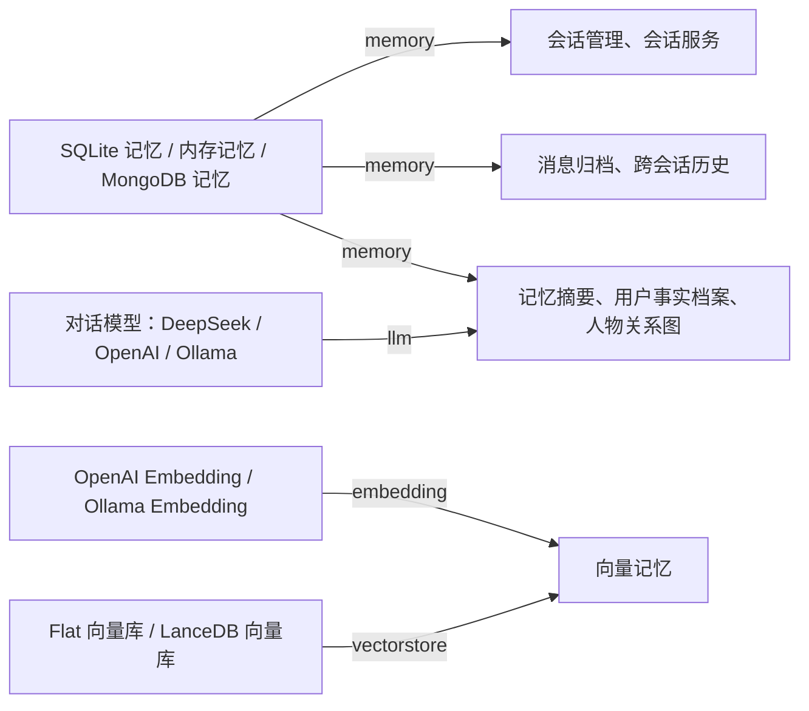

# 记忆由哪些插件组成

> 受众：用 Aalis 的人。讲记住对话靠哪几个插件、它们之间怎么依赖，以及缺了一环时界面上怎么显示。写插件要用的接口见 [memory 服务](../services/memory.md)。

Aalis 里没有一个叫「记忆」的插件。记住对话是几层插件配合完成的，每层要的东西不一样，只有最底下的消息存储是会话离不开的：

| 层 | 做什么 | 插件 | 要什么 |
|---|---|---|---|
| 消息存储 | 按会话存下每条消息，会话、归档与历史都从这里读写 | SQLite 记忆（默认）、内存记忆（重启就丢）、MongoDB 记忆，装一个即可 | SQLite 记忆要本地存储（默认就装）；MongoDB 记忆要一个在运行的 MongoDB |
| 会话、归档与历史 | 管会话；把收到与发出的消息写进存储；新会话里带上别处最近聊过的 | 会话管理、会话服务、消息归档、跨会话历史 | 消息存储 |
| 摘要与画像 | 长对话压成摘要；记下每个人的长期事实与人物之间的关系 | 记忆摘要、用户事实档案、人物关系图 | 消息存储；记忆摘要与用户事实档案还要一个对话模型，人物关系图用对话模型提取，没有也照常启动 |
| 语义记忆 | 按意思找回很久以前聊过的内容 | 向量记忆 | 一个 embedding 提供者与一个向量库 |

`npm create aalis` 的默认集装前三层，问「要长期语义记忆吗？」时答「要」（探到本机的 Ollama 时默认就是「要」）才装第四层（向量记忆、一个 embedding 提供者与 Flat 向量库），见[脚手架上手指南](./scaffolding.md#交互式提问)。

## 服务：插件之间的接口

插件之间靠服务连起来：一个插件声明提供某个服务，别的插件声明需要它。比如 SQLite 记忆提供 `memory`，会话管理需要 `memory`。需要的服务（required）此刻没有插件提供时，需要它的插件不启动；可选的（optional）缺了照常启动，只是少了相应的功能。同一个服务可以由不同的插件提供，换一个提供者不用改别的插件，SQLite 记忆换成 MongoDB 记忆就是这样换的。

记忆相关的几个服务：

| 服务 | 谁提供 | 谁需要 |
|---|---|---|
| `memory` | SQLite 记忆、内存记忆、MongoDB 记忆 | 会话管理、会话服务、消息归档、跨会话历史、记忆摘要、用户事实档案、人物关系图 |
| `llm` | DeepSeek、OpenAI、Ollama 等模型插件 | 记忆摘要、用户事实档案 |
| `embedding` | OpenAI Embedding、Ollama Embedding | 向量记忆 |
| `vectorstore` | Flat 向量库、LanceDB 向量库 | 向量记忆 |
| `session-manager` | 会话管理 | 会话服务 |
| `session-protocol` | 会话服务 | WebUI 的会话列表与会话页 |

插件详情的「依赖与贡献」一块列出这个插件要的服务各由谁提供。

## 缺一环时界面怎么显示

某个插件没起来，依赖它的插件跟着停在「缺服务」。WebUI 不只写缺了哪个服务，还沿着提供者往下追到真正出问题的那个插件（根），写出这条链，按钮直接去处理根。几种常见情形：

| 情形 | 「需要处理」里怎么写 |
|---|---|
| 选了 OpenAI Embedding 但没填 key | OpenAI Embedding 一行「待配置：apiKey」，按钮「去配置」；向量记忆一行「缺服务：OpenAI Embedding（待配置：apiKey）」，按钮「去配置 OpenAI Embedding」 |
| 卸掉了唯一的 embedding 提供者 | 向量记忆一行「缺服务：没有已装的插件提供 embedding，可以在插件市场按服务搜 embedding」。在插件市场搜 `embedding`，卡片写着「提供：embedding」的就是 |
| 停用了 Flat 向量库 | 向量记忆一行「缺服务：Flat 向量库（已停用）」；在向量记忆详情的「依赖与贡献」里一键「启用 Flat 向量库」 |
| SQLite 记忆打不开数据库 | SQLite 记忆一行「失败：」加修法与原因；会话管理、会话服务、消息归档等各一行「缺服务：SQLite 记忆（失败：…）」，按钮「去处理 SQLite 记忆」。首页与会话列表写「会话服务未启用」与「会话服务 → SQLite 记忆（失败：…）」，按钮同样去 SQLite 记忆 |
| 提供者还在启动 | 不进「需要处理」，插件树上写「等待启动」，它启动完自己就好了 |

终端里同样能看：欢迎行下面写「有 N 个插件没起来」，`/doctor` 的「未就绪」逐个写出这样的链，启动日志写「插件 "…" 依赖未满足，未激活：缺少服务 …」。各处的说法出自同一个判据，写法一致。

## 换后端与数据

- **换消息存储**：装上另一个记忆插件，停用或卸掉原来的。消息不会在两个后端之间迁移，换了之后从空开始。
- **换 embedding 或向量库**：向量记忆只认一个 embedding 提供者的向量，换了模型之后旧向量召回不出来；向量库的数据也不通用。换完可以用 `/clear all -t vector` 清空向量库，由新消息重新积累。
- **Ollama Embedding**：默认模型 `nomic-embed-text` 要先 `ollama pull nomic-embed-text`；没拉时向量索引每次都失败，`/doctor` 的 `service/embedding.ollama` 报不可用。
- **LanceDB**：Intel Mac 上装不了，用 Flat，见[安装与启动排障](./troubleshooting.md#intel-mac-与-lancedb)。
